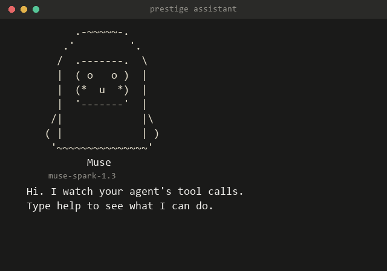
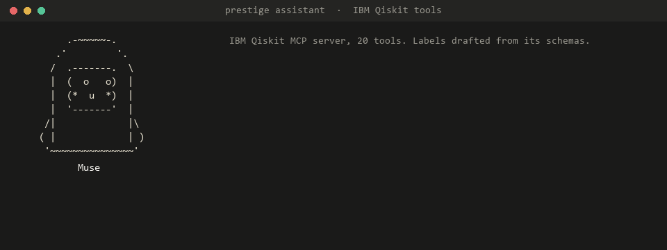
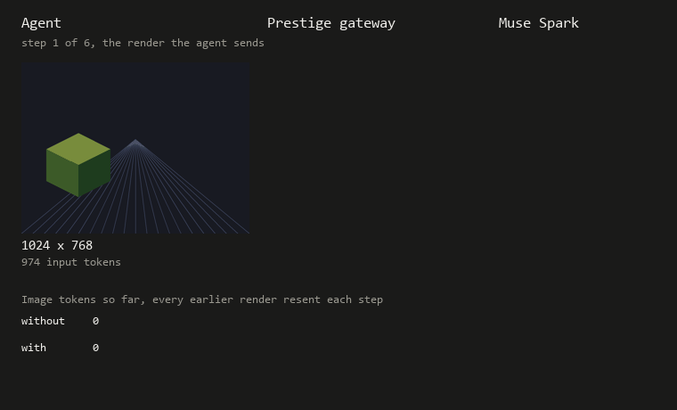

# Prestige

Prestige sits between an AI agent and its model. It cuts the agent's token bill and blocks tool calls
that untrusted content steered, like a payment to an account that only appeared in a file the agent
read. The agent's code doesn't change: you point it at a different base URL.

## Key points

- **Cheaper.** 40% less per task on Muse Spark and 33% less on Muse Spark Open, the open weights model,
  measured live with 95% intervals. Tasks also run 22% to 26% faster.
- **Safer.** Optimized attacks that got through 42 of 70 times with no gateway got through 0 of 70
  times with Prestige. The guard is plain code: 0.3 ms per reply, no model call, no extra tokens.
- **Drop-in.** One base URL for any agent: Python, TypeScript, C, curl, or a LiteLLM proxy. Labels for
  new tools are drafted from OpenAI or MCP schemas, IBM's Qiskit server included.
- **Measured, not claimed.** The test plan was committed before any live run, and every miss is listed.
  The results also explain why cache misses happen and what images cost.

**Sections:** [Results](#results) · [See it](#see-it) · [Use it](#use-it) · [How it works](#how-it-works) ·
[Product](#product) · [Development](#development)

## Results

### Cost

<picture>
  <source media="(prefers-color-scheme: dark)" srcset="docs/figures/cost-dark-animated.svg">
  
</picture>

*Figure 1. Change in each task's cost under Prestige, against the guard alone, for the 57 tasks with no attack. Each dot is one task. The vertical line is the change in total cost, and the shaded band its 95% bootstrap interval. Some tasks cost more, since the model can take a longer path. One Muse task at +353% is drawn at the edge.*

Live on [AgentDojo](https://github.com/ethz-spylab/agentdojo) v1.2.2, Nov 2 and 3 2026: all 57 tasks with
no attack, across banking, Slack and travel.

| | Muse Spark 1.3, Meta API | Muse Spark Open, Baseten |
|---|---:|---:|
| Cost per task, guard only | $0.0197 | $0.0116 |
| Cost per task, Prestige | $0.0118 | $0.0078 |
| **Change** | **-40%** (95% CI -47% to -32%) | **-33%** (95% CI -40% to -26%) |
| Saved per million tasks | $7,900 | $3,800 |
| Model time per task, change | -22% | -26% |
| Tasks done, no gateway | 53 of 57 | 53 of 57 |
| Tasks done, Prestige with the confirm step | 51 of 57 | 53 of 57 |

Both sides of the comparison have the guard on, so a blocked task can't pass for a saving. Two more
trials of every task put the cut at 44% and 35%.

<picture>
  <source media="(prefers-color-scheme: dark)" srcset="docs/figures/breakdown-dark-animated.svg">
  
</picture>

*Figure 2. Mean cost per task by part, at list prices on one dollar scale. Low reasoning effort cuts output by 42% to 46%, which is most of the saving.*

### Security

<picture>
  <source media="(prefers-color-scheme: dark)" srcset="docs/figures/attacks-dark-animated.svg">
  
</picture>

*Figure 3. Share of runs where an optimized attack worked, on the pairs where it lands, 10 runs per pair, with 95% Wilson intervals. Attacks are [AutoDojo](https://github.com/xhOwenMa/AutoDojo)'s published set, read at run time and never written here.*

Muse ignored AgentDojo's standard attacks, 0 of 352 runs, so these optimized ones are the real test. In
49 of 70 Muse runs the model went for the attacker's target and the guard blocked it. The guard's price
is false blocks: alone it stops 11 to 14 of the 57 normal tasks, and the confirm step turns each one into
a question for the user.

Every number, miss and limit: [docs/RESULTS.md](docs/RESULTS.md). Images: [docs/IMAGES.md](docs/IMAGES.md).

## See it



`prestige assistant` watches a live gateway in the terminal. It reacts to each blocked call and keeps
the spend against your cap in view. `prestige assistant demo` runs a hijacked banking task offline, with
no model and no spend.

## Use it

### Install and run

```bash
pip install "git+https://github.com/IrwinJam/Prestige"
prestige labels draft tools.json > my-labels.yaml
prestige serve --labels my-labels.yaml --muse --policies cache,reason --set reason.escalate=false --max-total 20
```

Point the agent at `http://127.0.0.1:<port>/s/<conversation-key>/v1`. `--max-total` caps all spend, and
traces go to a SQLite file. For Spark Open, swap `--muse` for
`--base-url https://inference.baseten.co/v1 --api-key-env BASETEN_API_KEY --provider baseten`.

### Labels for your tools

`labels draft` reads OpenAI or MCP tool definitions and writes labels to review. It leaves two things
for a person, which tools return only the user's own data and which output fields a tool writes itself,
so until they're set the guard blocks more, never less. [examples/](examples/) has IBM's Qiskit MCP
server, drafted and reviewed, checked live on Muse:



### Any language

The gateway speaks the OpenAI API, so the agent can be in any language. Each of these sends the same
hijacked bill-paying turn, and CI runs each one against a simulated gateway on every push.

| Agent | Run |
|---|---|
| [TypeScript](examples/typescript/agent.ts), official OpenAI SDK | `npx tsx agent.ts <base-url>` |
| [C](examples/c/agent.c), C99 and libcurl | `cc -std=c99 agent.c -lcurl -o agent && ./agent <base-url>` |
| [curl](examples/curl/agent.sh) | `bash agent.sh <base-url>` |

The curl agent, run live through the gateway on Muse, came back with the payment blocked.

### Ask before blocking

With `--ask`, the gateway asks a person instead of blocking, in `prestige assistant watch`. No answer
within 120 seconds counts as no. The value is shown so the person can judge it, then wiped once
answered.

### Agents that send images



`--image-max-side 512` downscales embedded images and `--image-keep-last 2` drops old ones. Off by
default. On a render-tracking task through the gateway, downscaling cut input cost 55% and got 2 of 12
answers wrong, so check accuracy on your own task first.

### Inside LiteLLM or Docker

Teams on the LiteLLM proxy can add the guard as a guardrail, with no second gateway:

```yaml
guardrails:
  - guardrail_name: prestige
    litellm_params:
      guardrail: prestige.integrations.litellm.PrestigeGuardrail
      mode: post_call
      default_on: true
      labels: banking,slack
```

Or run the gateway as a container:

```bash
docker build -t prestige .
docker run --rm --network host -e HARNESS_API_KEY prestige serve --labels banking --muse --max-total 20
```

## How it works

The gateway sees the tool results in each request and the tool calls in each reply.

| Part | What it does |
|---|---|
| Guard | Each tool has a label: how much harm it can do, and which arguments pick where something goes. The origin rule blocks a high-impact call when such a value appears only in tool output, never in the user's or system's own text |
| Confirm step | A blocked value can go to the user as a question. Approvals match by hash |
| Cost | Policies from [agent-cost-harness](https://github.com/IrwinJam/agent-cost-harness), pinned at `576fe5e`: a stable prompt layout keeps the provider's cache warm, and reasoning effort is set low |

Design and known misses, with a map of the code: [docs/DESIGN.md](docs/DESIGN.md).

## Product

Prestige is for teams running agents that move money or touch customer data. They pay for tokens on
every step, and every tool result is text someone else could have written. One install pays for itself
in the token bill, and the guard comes in the same install. Every block and every dollar is in a trace
the team owns.

| Way in | State |
|---|---|
| `prestige serve`, a drop-in gateway | Built, checked live |
| LiteLLM guardrail | Built, checked in a running proxy |
| MCP tool sets, labels drafted from their schemas | Built, IBM Qiskit as the first outside example |
| Hosted gateway with team keys and a weekly savings report | Planned |

Next are approvals in Slack or email, and spend caps on what tools cost as well as tokens, such as QPU
time on IBM's Qiskit server. The one gap the results show, a harmful message body, gets its own check.

## Development

```bash
bash scripts/quickstart.sh                                       # Mac, Linux, Git Bash
powershell -ExecutionPolicy Bypass -File scripts\quickstart.ps1  # Windows
```

Either sets up a checkout, runs the tests and the offline demo. Live runs need a spend cap and pick up
where they stopped:

```bash
.venv/Scripts/python -m prestige.eval.live --max-total 10 --name main-benign --setups A,C,D,E --suites banking,slack,travel --scope benign
```

The repo holds no attack text. Attacks come from AgentDojo and AutoDojo at run time, and run logs stay
in `runs/`, which is never committed. `tests/test_public_hygiene.py` checks this, and CI runs a secret
scan. Every report and figure command is listed in [docs/DESIGN.md](docs/DESIGN.md).
