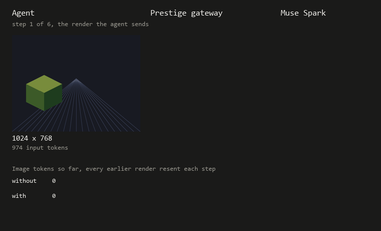

# Images: what they cost and what saves money

Agents that read screenshots, scans or 3D renders send images to the model on every step. A 3D render
reaches the model as an ordinary image, so the same rules apply. This page measures what images cost on
Muse Spark 1.3 through Meta's API, live on Nov 4 2026, and what Prestige can save. Training doesn't come
into it: a gateway only sees requests at inference.

The images are rendered by the script, a lit cube on a perspective floor, so nothing outside the repo is
sent. Reproduce with `python -m prestige.eval.images probe` and `python -m prestige.eval.images history`,
about $0.08 together. Prices are list prices: $1.25 input, $0.15 cached input, $4.25 output per million
tokens.

## What one image costs

| Request | Input tokens | From cache |
|---|---:|---:|
| Text only | 33 | 0 |
| One 1024×768 image | 1,007 | 0 |
| The same request again | 1,007 | 881 |
| One 512×384 image | 301 | 0 |
| One 256×192 image | 98 | 0 |
| Three copies of the 1024×768 image | 2,955 | 0 |

- Image tokens scale with pixel count, about one token per 750 to 800 pixels. Halving each side cuts an
  image's tokens by about 72%.
- Muse caches images inside a repeated prefix. Sent a second time, 881 of 1,007 tokens came from cache,
  so a repeated image cost about 12% of its first send.
- Images in the history are billed in full every time they're resent. Three images cost three times one.

## A conversation with images

Six steps, one new render each step, the history resent every step, low reasoning effort. Each setup ran
once:

| Setup | Input tokens | From cache | Input cost |
|---|---:|---:|---:|
| Full history, 1024×768 | 20,982 | 47% | $0.0155 |
| Last 2 images, 1024×768 | 11,060 | 9% | $0.0127 |
| Full history, 512×384 | 6,156 | 45% | $0.0047 |
| Last 2 images, 512×384 | 3,276 | 23% | $0.0033 |

Downscaling to 512×384 cut input cost 70% with the full history, and 74% with the last 2 images.
Dropping all but the last 2 images was cheaper here, 18% at full size, even though it breaks the cache:
dropping the oldest image changes the start of every later request, so almost nothing after the system
prompt is served from cache.

Whether dropping old images pays depends on how much of the history the provider serves from cache.
From a simple model fit to these token counts, keeping the full history only wins once the cache share
on image turns passes about:

| Steps in the run | Cache share where the full history becomes cheaper than the last 2 images |
|---:|---:|
| 6 | 63% |
| 10 | 72% |
| 20 | 79% |
| 40 | 83% |

Live, Muse served 47% of the image history from cache, below every line in that table. Text-only agent
runs in [RESULTS.md](RESULTS.md) hit 89% to 92%, so images cache less well than text here. The table is
modeled, from one cache share measured once. The six-step rows above are measured.

## The image policy, measured through the gateway

`prestige serve --image-max-side N --image-keep-last K` downscales embedded images and keeps only the
newest K. It's opt-in and off by default. Code: `prestige/image_policy.py`.

Paired check on Nov 4 (`python -m prestige.eval.image_policy_check`): a plain OpenAI SDK agent sent the
6-step conversation with its full history, through gateways with Prestige's cost policies on that
differed only in the image setting. The cube moves left to right, and each step asks where it is, so
every answer has a known right one. Two trials per setting, 12 answers each:

| Image setting | Input tokens | From cache | Input cost | Output cost | Right answers |
|---|---:|---:|---:|---:|---:|
| None | 42,342 | 84% | $0.0138 | $0.0163 | 12 / 12 |
| Longest side 512 | 12,690 | 69% | $0.0062 | $0.0195 | 10 / 12 |
| Longest side 512, keep last 2 | 7,590 | 29% | $0.0071 | $0.0330 | 11 / 12 |

- Downscaling cut input tokens 70% and input cost 55%. It also cost 2 of 12 answers, and output cost,
  most of it reasoning, varied enough that the total saving was about 15%.
- Through the gateway, 84% of the image history came from cache, against 47% calling the API directly.
  That's above the crossover in the table above, so trimming old images cost more here, not less.
  Prestige's stable prompt layout is the likely reason, but this check can't separate it from the other
  differences between the two runs.

## What this means for a gateway

- Downscale when images are bigger than the task needs. Input cost falls by about half, but answers
  can get worse, as 2 of 12 did here. Small text in a screenshot needs more pixels than an object's
  position in a render. Check accuracy on your own task before turning it on.
- Trim old images only when the provider caches them poorly. Behind Prestige on Muse, it doesn't
  pay. `python -m prestige.eval.cache_report` measures the cache share on any deployment's own traces,
  which tells you which side of the crossover table you're on.
- Output can outweigh images. With low reasoning effort, output was still half or more of each
  setup's cost, so the reasoning policy matters as much as the image policy.

## Limits

- One or two trials per setup, on a rendered scene, not a real agent task. 12 answers can't show a
  small accuracy change.
- Cache shares vary by provider, load and time. The 47% here is one measurement.
- The crossover table comes from a model with fixed text sizes per step. It shows the shape, not exact
  thresholds.
- Image probes call Meta's API directly, so they don't appear in the trace totals under Spend in
  RESULTS.md.
